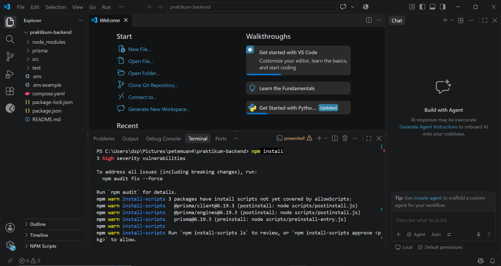
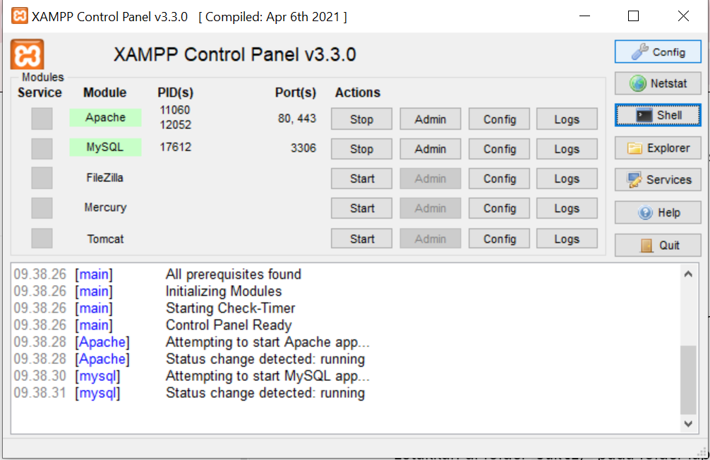
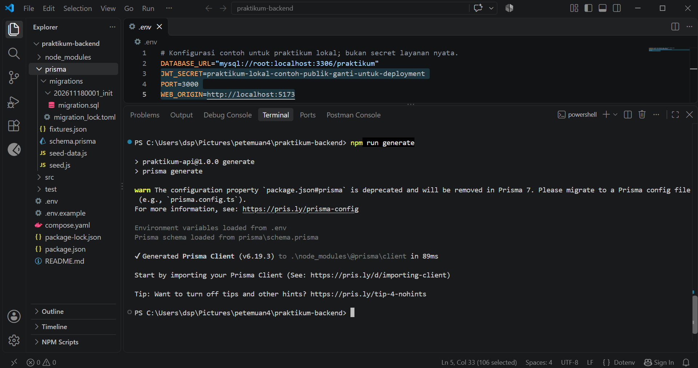
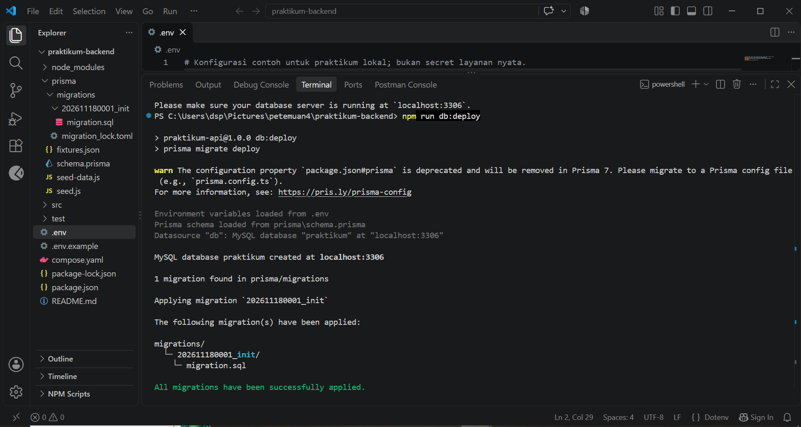
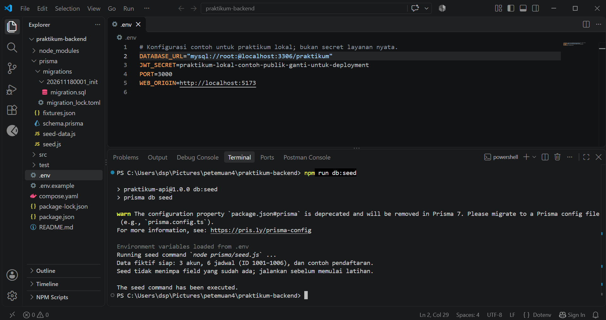
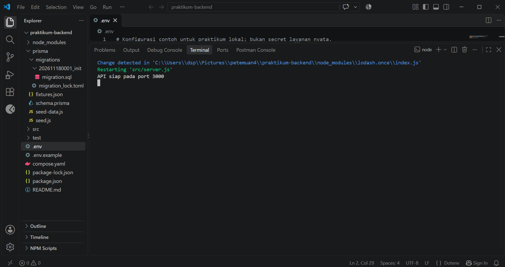
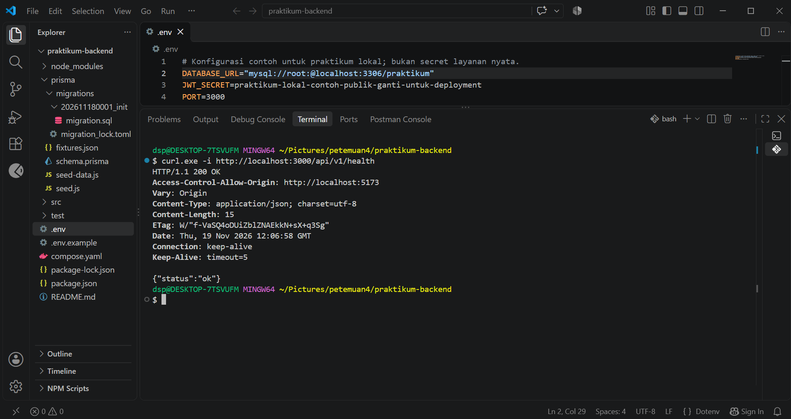
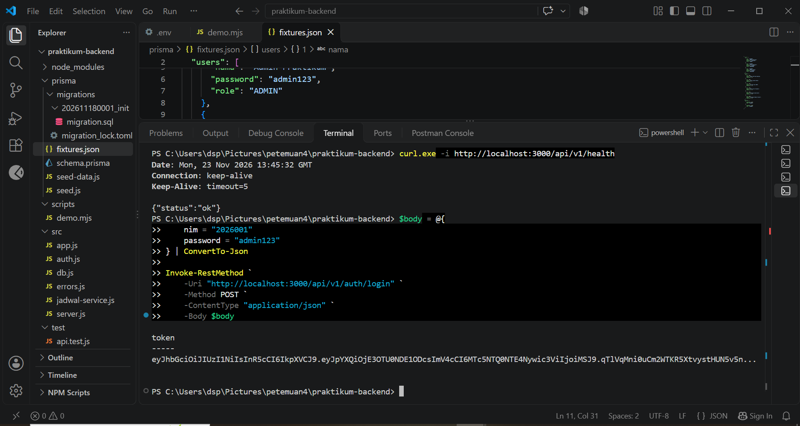
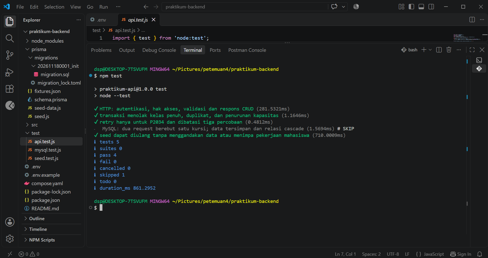
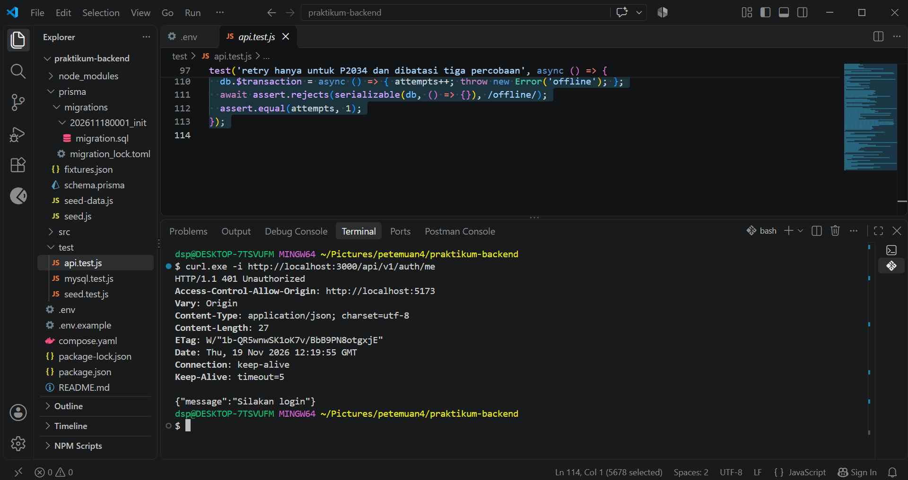

# LAPORAN PRAKTIKUM 04
# IMPLEMENTASI BACKEND DAN DATABASE MYSQL

## 1. Tujuan Praktikum

Praktikum ini bertujuan untuk memahami proses implementasi backend yang terhubung dengan database MySQL. Melalui praktikum ini, mahasiswa mempelajari cara mempersiapkan project backend, melakukan instalasi package, menjalankan database, serta menggunakan Prisma ORM untuk mengelola data.

Selain itu, praktikum ini bertujuan agar mahasiswa memahami proses kerja backend dalam menerima permintaan pengguna, melakukan validasi, memproses data, menyimpan data ke database, dan memberikan respons melalui API.

## 2. Persiapan Praktikum

Sebelum memulai praktikum, beberapa perangkat lunak yang digunakan adalah:

| No. | Perangkat | Kegunaan |
|---|---|---|
| 1 | Visual Studio Code | Membuka dan mengelola source code. |
| 2 | Node.js | Menjalankan aplikasi backend. |
| 3 | npm | Mengelola dan memasang package. |
| 4 | Docker Desktop | Menjalankan database menggunakan Docker Compose. |
| 5 | MySQL | Menyimpan data aplikasi. |
| 6 | Prisma ORM | Menghubungkan backend dengan database. |
| 7 | PowerShell | Menjalankan perintah melalui terminal. |

## 3. Langkah-Langkah Pengerjaan

### 3.1 Membuka Project Backend

Project backend yang telah diunduh dari lampiran praktikum diekstrak ke dalam komputer. Selanjutnya, folder project dibuka menggunakan Visual Studio Code.

Folder yang digunakan adalah `praktikum-backend`. Terminal dibuka pada folder utama project yang berisi file `package.json` agar perintah praktikum dapat dijalankan pada direktori yang benar.

### 3.2 Instalasi Package

Instalasi package dilakukan menggunakan perintah berikut:

```bash
npm install
```

Perintah tersebut digunakan untuk mengunduh dan memasang seluruh package yang dibutuhkan oleh aplikasi berdasarkan konfigurasi pada file `package.json`.

Hasil instalasi menunjukkan bahwa sebanyak 128 package berhasil ditambahkan dan 129 package telah diaudit. Terdapat pula beberapa peringatan keamanan dan install script Prisma yang perlu diperiksa lebih lanjut.

**Bukti instalasi package:**



### 3.3 Menjalankan Database MySQL

Pada praktikum ini, database dijalankan menggunakan MariaDB melalui XAMPP sebagai alternatif karena Docker Compose tidak dapat digunakan. Database berjalan pada port 3306 dan digunakan oleh backend melalui Prisma ORM.

```bash
# Menjalankan database melalui XAMPP Control Panel
```

Setelah perintah dijalankan, dilakukan pemeriksaan untuk memastikan container database berhasil berjalan.

**Bukti database MySQL berjalan:**



### 3.4 Menjalankan Prisma Generate

Prisma ORM digunakan untuk membantu backend berkomunikasi dengan database. Proses generate dilakukan untuk menghasilkan Prisma Client berdasarkan struktur database yang telah didefinisikan.

Perintah yang digunakan:

```bash
npm run generate
```

Apabila proses berhasil, Prisma Client dapat digunakan oleh aplikasi backend untuk melakukan operasi terhadap database.

**Bukti Prisma Generate:**



### 3.5 Menjalankan Migrasi Database

Migrasi database dilakukan untuk menerapkan struktur tabel yang telah didefinisikan pada file schema Prisma ke dalam database MySQL.Proses ini bertujuan agar tabel dan relasi yang dibutuhkan oleh aplikasi tersedia di dalam database. Berdasarkan pemeriksaan file `migration.sql`, proses migrasi menghasilkan tiga tabel utama, yaitu `User`, `Jadwal`, dan `Peserta`. Tabel `User` memiliki primary key `id` serta unique index pada kolom `nim` untuk mencegah penggunaan NIM yang sama. Tabel `Jadwal` digunakan untuk menyimpan informasi jadwal, kapasitas, dan waktu pembuatan. Sementara itu, tabel `Peserta` menghubungkan pengguna dengan jadwal melalui kolom `userId` dan `jadwalId`.
Pada tabel `Peserta` terdapat unique index gabungan pada kolom `jadwalId` dan `userId` untuk mencegah pengguna mendaftar lebih dari satu kali pada jadwal yang sama. Selain itu, terdapat dua foreign key yang menghubungkan tabel `Peserta` dengan tabel `Jadwal` dan `User`. Kedua relasi tersebut menggunakan aturan `ON DELETE CASCADE` dan `ON UPDATE CASCADE`, sehingga perubahan atau penghapusan data pada tabel induk dapat diterapkan pada data yang berelasi sesuai aturan tersebut.

Dengan demikian, struktur tabel, primary key, unique index, dan foreign key pada file migration SQL telah menunjukkan relasi basis data yang sesuai dengan kebutuhan sistem.

Perintah yang digunakan:

```bash
npm run db:deploy
```

**Bukti migrasi database:**



### 3.6 Memasukkan Data Awal Menggunakan Seed

Seed merupakan proses memasukkan data awal atau data contoh ke dalam database. Data tersebut digunakan untuk membantu proses pengujian aplikasi. Data awal dapat berupa akun pengguna, jadwal kegiatan, dan contoh pendaftaran peserta sesuai data yang tersedia pada project. 
Pengujian seed dilakukan dengan mengubah nama pengguna dengan NIM `2026002` pada file `fixtures.json`, dari `Citra Contoh` menjadi `Citra Pengujian`. Setelah perubahan disimpan, perintah `npm run db:seed` dijalankan kembali dan proses seed berhasil diselesaikan.
Berdasarkan pemeriksaan tabel `User` melalui phpMyAdmin, nama pengguna dengan NIM `2026002` tetap tercatat sebagai `Citra Contoh`, meskipun nama pada file fixture telah diubah menjadi `Citra Pengujian`. Hal ini terjadi karena mekanisme `upsert` pada program seed tidak memperbarui field yang sudah ada. Dengan demikian, data pengguna yang sebelumnya tersimpan tetap dipertahankan.

Hasil pengujian menunjukkan bahwa proses seed tidak menimpa data pengguna yang sudah tersedia di database.

Perintah yang digunakan:

```bash
npm run db:seed
```

Setelah proses selesai, dilakukan pemeriksaan untuk memastikan data awal berhasil dimasukkan ke database.

**Bukti proses seed:**



### 3.7 Menjalankan Backend

Setelah database dan konfigurasi Prisma siap, aplikasi backend dijalankan menggunakan perintah:

```bash
npm run dev
```

Perintah tersebut digunakan untuk menjalankan server backend dalam mode pengembangan.

Backend berjalan menggunakan port 3000 agar API dapat menerima permintaan dari aplikasi atau pengguna.

**Bukti backend aktif:**



### 3.8 Melakukan Health Check

Health check dilakukan untuk memastikan bahwa server backend dapat diakses dan memberikan respons dengan baik.

Pemeriksaan dilakukan menggunakan perintah:

```bash
curl -i http://localhost:3000/api/v1/health
```

Hasil yang diharapkan adalah status HTTP 200 dengan respons:

```json
{
  "status": "ok"
}
```

Hasil tersebut menunjukkan bahwa API berjalan dengan baik dan dapat memberikan respons sesuai yang diharapkan.
Pengujian login dilakukan untuk memastikan bahwa proses autentikasi pengguna dapat berjalan dengan baik. Pengujian dilakukan menggunakan akun Admin yang telah tersedia melalui proses seed, dengan NIM `2026001` dan password `admin123`.

Berdasarkan hasil pengujian melalui endpoint `/api/v1/auth/login`, sistem berhasil memverifikasi kredensial pengguna dan memberikan token JWT sebagai bukti autentikasi berhasil. Dengan demikian, endpoint login telah berjalan sesuai dengan fungsinya.


**Bukti health check:**



**Gambar 10. Hasil Pengujian Login Admin**




## 4. Penjelasan Source Code

### 4.1 schema.prisma

File `schema.prisma` digunakan untuk mendefinisikan struktur database yang akan digunakan oleh aplikasi.

Di dalam file tersebut terdapat konfigurasi datasource MySQL dan model yang menggambarkan tabel beserta hubungan antar tabel.

### 4.2 seed.js

File `seed.js` digunakan untuk menjalankan proses pengisian data awal ke database. File ini memanggil fungsi seed yang telah disediakan dan menampilkan informasi setelah proses selesai.

### 4.3 seed-data.js

File `seed-data.js` berisi proses utama untuk memasukkan data contoh ke database. Proses tersebut meliputi pembacaan data fixture, pembuatan hash password, penyimpanan akun pengguna, penyimpanan jadwal, serta pemeriksaan kapasitas pendaftaran.

### 4.4 fixtures.json

File `fixtures.json` digunakan untuk menyimpan data contoh yang akan dimasukkan ke database, seperti data pengguna, jadwal kegiatan, dan contoh pendaftaran peserta.

### 4.5 db.js

File `db.js` digunakan untuk mengatur koneksi Prisma Client dengan database sehingga aplikasi backend dapat melakukan operasi pengelolaan data.

### 4.6 server.js

File `server.js` digunakan untuk menjalankan server backend, menghubungkan aplikasi dengan database, dan mengatur port yang digunakan oleh API.

## 5. Perubahan Kode

Pada praktikum ini tidak dilakukan perubahan pada source code backend yang disediakan dalam lampiran praktikum. Perubahan hanya dilakukan pada file konfigurasi .env, yaitu menyesuaikan alamat koneksi database agar dapat menggunakan MariaDB dari XAMPP.

| Keterangan | Penjelasan |
|---|---|
| Lokasi file | .env |
| Bagian kode | Konfigurasi DATABASE_URL diubah menjadi mysql://root@localhost:3306/praktikum. |
| Alasan perubahan | Menyesuaikan koneksi database dengan MariaDB XAMPP yang berjalan pada port 3306 karena Docker tidak dapat digunakan. |
| Hasil perubahan | Backend berhasil terhubung dengan database, migrasi berhasil diterapkan, dan data awal berhasil dimasukkan menggunakan seed. |

Apabila tidak melakukan perubahan kode, jelaskan bahwa source code masih menggunakan kode yang disediakan pada lampiran praktikum.

## 6. Hasil Pengujian

Pengujian dilakukan untuk mengetahui apakah aplikasi backend dapat menjalankan fungsi sesuai kebutuhan. Pengujian terdiri dari skenario berhasil dan skenario gagal.

### 6.1 Pengujian Berhasil

Pengujian berhasil dilakukan dengan menjalankan perintah npm test. Hasil pengujian menunjukkan bahwa terdapat 4 pengujian yang berhasil, 0 pengujian gagal, dan 1 pengujian dilewati (skipped). Sistem dapat memproses permintaan sesuai dengan ketentuan yang telah ditentukan.

**Bukti pengujian berhasil:**



### 6.2 Pengujian Gagal

Pengujian gagal dilakukan dengan memberikan input yang tidak sesuai atau kondisi yang menyebabkan permintaan tidak dapat diproses. Pengujian ini bertujuan mengetahui bagaimana sistem menangani kesalahan dan memberikan respons kepada pengguna.Pengujian dilakukan dengan mengakses endpoint `/api/v1/auth/me` tanpa menyertakan token autentikasi. Hasil pengujian menunjukkan bahwa sistem memberikan respons HTTP 401 Unauthorized dengan pesan "Silakan login". Hal ini menunjukkan bahwa sistem berhasil menolak permintaan dari pengguna yang belum melakukan autentikasi sehingga akses tetap terlindungi.

**Bukti pengujian gagal:**



### 6.3 Ringkasan Hasil Pengujian

| No. | Skenario Pengujian | Hasil yang Diharapkan | Hasil Aktual |
|---|---|---|---|
| 1 | Instalasi package | Package berhasil dipasang | [Berhasil, sebanyak 128 package berhasil dipasang.] |
| 2 | Menjalankan database | Database aktif | [Berhasil, MariaDB XAMPP versi 10.4.32 berjalan pada port 3306.] |
| 3 | Prisma Generate | Prisma Client berhasil dibuat | [Berhasil, Prisma Client versi 6.19.3 berhasil dibuat.] |
| 4 | Migrasi database | Struktur tabel berhasil diterapkan | [Berhasil, 1 migrasi berhasil diterapkan pada database praktikum] |
| 5 | Seed database | Data awal berhasil dimasukkan | [Berhasil, 3 akun, 6 jadwal, dan contoh pendaftaran berhasil disiapkan.] |
| 6 | Menjalankan backend | Backend aktif pada port 3000 | [Berhasil, API aktif pada port 3000.] |
| 7 | Health check | API memberikan respons HTTP 200 | [Berhasil, API memberikan respons HTTP 200 OK dengan status ok.] |
| 8 | Pengujian berhasil | Permintaan diproses sesuai ketentuan | [Berhasil, 4 pengujian lulus dan tidak ada pengujian yang gagal] |
| 9 | Pengujian gagal | Sistem menangani kesalahan dengan baik | [Berhasil, sistem menolak akses tanpa login dengan respons HTTP 401 Unauthorized dan pesan Silakan login] |

## 7. Jawaban Pertanyaan Praktikum

### 7.1 Dari mana input fitur berasal dan di file mana input tersebut diperiksa?

Input fitur berasal dari pengguna melalui permintaan yang dikirimkan ke API. Permintaan tersebut diterima oleh backend melalui endpoint yang telah disediakan. Selanjutnya, input diperiksa melalui proses validasi pada bagian route, controller, atau fungsi validasi sesuai struktur source code sebelum diproses lebih lanjut.

### 7.2 Fungsi apa yang mengubah data atau state, dan kapan respons ditampilkan kepada pengguna?

Perubahan data dilakukan oleh fungsi yang menjalankan proses penyimpanan, pembaruan, atau penghapusan data melalui Prisma Client. Setelah proses pengolahan data selesai, backend mengirimkan respons melalui API sehingga pengguna dapat mengetahui apakah permintaannya berhasil atau gagal.

### 7.3 Apa yang terjadi jika request gagal pada titik sebelum penyimpanan dan sesudah penyimpanan? Gunakan satu fungsi konkret dari source di atas.

Jika permintaan gagal sebelum proses penyimpanan dilakukan, data peserta belum masuk ke database. Contohnya pada fungsi `daftarPeserta()`, sistem terlebih dahulu memeriksa apakah jadwal tersedia, apakah mahasiswa sudah terdaftar, dan apakah kapasitas kelas masih mencukupi. Jika jadwal tidak ditemukan, mahasiswa sudah terdaftar, atau kelas penuh, proses pendaftaran akan ditolak dan data peserta tidak disimpan.

Namun, apabila terjadi kegagalan setelah proses penyimpanan berhasil dilakukan, terdapat kemungkinan data sudah tersimpan meskipun pengguna menerima respons gagal, misalnya jika kegagalan terjadi setelah transaksi selesai tetapi sebelum respons diterima pengguna.

Fungsi `daftarPeserta()` menggunakan transaksi database dengan tingkat isolasi `Serializable` untuk menjaga konsistensi data. Jika terjadi kegagalan selama transaksi berlangsung, transaksi dapat dibatalkan sehingga perubahan tidak tersimpan. Dengan demikian, transaksi membantu mencegah ketidakkonsistenan data.

## 8. Kesimpulan

Berdasarkan praktikum yang telah dilakukan, dapat disimpulkan bahwa backend memiliki peran penting dalam mengatur proses pengolahan data pada aplikasi. Backend menerima permintaan pengguna, melakukan validasi, memproses data, menyimpan data ke database, dan memberikan respons melalui API.

Dalam praktikum ini, Node.js digunakan untuk menjalankan backend, MySQL digunakan sebagai tempat penyimpanan data, sedangkan Prisma ORM membantu proses komunikasi antara backend dan database.

Melalui praktikum ini, mahasiswa memperoleh pemahaman mengenai instalasi package, menjalankan database, melakukan generate Prisma Client, migrasi database, memasukkan data awal menggunakan seed, menjalankan server backend, serta melakukan pengujian API.